# AA Book (`aabook`)

## What AA Book Is

AA Book is Arkansas Automated's installable front desk booking agent for home services shops and appointment businesses (HVAC, plumbing, electrical, garage doors, exterior cleaning).

Instead of running on a shared multi-tenant web server, AA Book installs onto a small always-on computer at the client's shop (a Mac Mini or Linux mini-PC). It:

1. **Texts back missed calls** with the shop's greeting and offers to book by text.
2. **Books, reschedules, and cancels jobs** against the shop's hours, service catalog, zip codes, and calendar.
3. **Follows up on open estimates** on day 2, day 5, and day 10—and stops immediately if the customer calls or texts back.
4. **Requests Google reviews** after a completed job.
5. **Keeps client data on the machine** inside a local SQLite database (`data/aabook.sqlite`) with a full audit log. Secrets stay strictly in `.env` and never enter client JSON files, templates, or backups.

If a caller or texter ever asks whether they are speaking to an AI, AA Book always answers honestly using the disclosure line in `client/persona.json`.

---

## Quickstart: One-Command Install

AA Book runs on [Bun](https://bun.sh) (`v1.1.0` or newer). If Bun is not installed yet on a fresh machine:

```bash
curl -fsSL https://bun.sh/install | bash
```

Clone the repo and run the one install command:

```bash
git clone git@github.com:andrebrassfield/AA-Agent.git
cd AA-Agent
./bin/aabook.js install
```

What `./bin/aabook.js install` does in one step:
- Checks that Bun is installed and new enough (or prints plain-English fix instructions).
- Installs project dependencies (`bun install --frozen-lockfile`).
- Scaffolds `data/`, starter client config files in `client/`, `.env.example`, and `.env` (with empty secret placeholders).
- Links the `aabook` command onto your `PATH` (for example `~/.bun/bin/aabook`) so you can run `aabook` directly.
- Safe to run twice: if everything is already in place, it changes nothing, preserves your edits, and prints `Already installed — nothing changed.`

---

## System Architecture & Dependency Map

Every arrow in the graph below corresponds to a real `import` statement or runtime call across `bin/` and `src/`.

```mermaid
graph TD
  subgraph CLI_LAYER["CLI Entry and Commands"]
    BIN["bin/aabook.js (Bun >= 1.1.0 guard)"]
    INDEX["src/index.ts (CLI main)"]
    CMD_INSTALL["src/cli/install.ts (install)"]
    SERVICE_MOD["src/cli/service.ts (launchd / systemd + slugify)"]
    CMD_SETUP["src/cli/setup.ts (setup)"]
    CMD_STATUS["src/cli/status.ts (status)"]
    CMD_SERVE["src/cli/serve.ts (serve)"]
    CMD_USAGE["src/cli/usage.ts (usage -- read-only)"]
    CMD_BACKUP["src/cli/backup.ts (backup / restore)"]
    CMD_DEMO["src/demo/runner.ts + shop_data.ts (demo)"]
  end

  subgraph CONFIG_LAYER["Client Config Loader and Validator"]
    LOADER["src/config/loader.ts (loadClientConfig / writeClientConfig)"]
    VALIDATOR["src/config/validator.ts (schema + TODO + secret guards)"]
  end

  subgraph INGRESS_LAYER["Webhook Server, Channel Adapters, and Compliance"]
    SERVER["src/server/server.ts + redact.ts (Bun.serve)"]
    REGISTRY["src/channels/registry.ts (ChannelAdapterRegistry)"]
    VOICE_RETELL["src/channels/voice/retell.ts (RetellVoiceAdapter -- live)"]
    VOICE_11L["ElevenLabs Voice (seam only -- no adapter yet)"]
    SMS_TWILIO["src/channels/sms/twilio.ts (TwilioSmsProvider -- live)"]
    SMS_STUB["src/channels/sms/stub.ts (StubSmsProvider -- demo/tests)"]
    COORD["src/channels/coordinator.ts (ChannelCoordinator)"]
    COMPLIANCE["src/channels/sms/compliance.ts (STOP / START / HELP classifier)"]
  end

  subgraph ENGINE_LAYER["EngineAdapter, Runtimes, and MCP Server"]
    ENG_IFACE["src/types/engine.ts (EngineAdapter)"]
    ENG_CORE["src/engine/core.ts (CoreEngine -- default)"]
    ENG_PI["src/engine/pi.ts (PiEngine)"]
    PI_PKG["@earendil-works/pi-coding-agent (pi JSON stdio)"]
    ENG_OMP["src/engine/omp.ts (OmpEngine -- omp-agent stdio)"]
    MCP_SRV["src/mcp/booking-server.ts (@modelcontextprotocol/sdk stdio)"]
  end

  subgraph ROUTER_LAYER["ProviderRouter and Model Providers"]
    PROV_INIT["src/router/providers.ts (buildConfiguredRouter)"]
    ROUTER["src/router/router.ts (ProviderRouter)"]
    PROV_OAI["OpenAiCompatibleProvider (OpenAI, OpenRouter, NVIDIA NIM)"]
    PROV_ANT["AnthropicProvider (Anthropic Messages)"]
    PROV_GEM["GeminiProvider (Gemini generateContent)"]
    PROV_STUB["src/router/stub.ts (StubModelProvider -- demo/tests)"]
  end

  subgraph WORKFLOW_LAYER["Workflows, FollowUpDispatcher, and Calendar"]
    WF_BOOK["src/workflows/booking.ts (booking)"]
    WF_MISSED["src/workflows/missed_call.ts (missed-call text-back)"]
    WF_EST["src/workflows/estimate.ts (estimate touches + reply stop)"]
    WF_REV["src/workflows/review.ts (review requests)"]
    DISPATCH["src/workflows/dispatcher.ts (FollowUpDispatcher)"]
    CAL_IFACE["src/calendar/calendar.ts (CalendarAdapter)"]
    CAL_GCAL["GoogleCalendarAdapter (WebCrypto JWT + Calendar v3)"]
    CAL_FAKE["FakeCalendar (in-memory)"]
  end

  subgraph DATA_LAYER["DataStore and SQLite Tables (data/aabook.sqlite)"]
    STORE["src/db/store.ts (DataStore)"]
    TBL_BOOK["Tables: bookings, estimates, reviews"]
    TBL_CALLS["Tables: call_logs, conversation_messages, missed_call_dedupe, audit_logs"]
    TBL_FUP["Table: scheduled_followups"]
    TBL_OPT["Table: sms_opt_outs"]
    TBL_USAGE["Table: model_usage"]
  end

  BIN --> INDEX
  INDEX --> CMD_INSTALL
  INDEX --> CMD_SETUP
  INDEX --> CMD_STATUS
  INDEX --> CMD_SERVE
  INDEX --> CMD_USAGE
  INDEX --> CMD_BACKUP
  INDEX --> CMD_DEMO

  CMD_INSTALL --> SERVICE_MOD
  CMD_BACKUP --> SERVICE_MOD

  LOADER --> VALIDATOR
  CMD_INSTALL --> LOADER
  CMD_INSTALL --> VALIDATOR
  CMD_SETUP --> LOADER
  CMD_SETUP --> VALIDATOR
  CMD_STATUS --> LOADER
  CMD_STATUS --> STORE
  CMD_SERVE --> LOADER
  CMD_SERVE --> CMD_USAGE
  CMD_BACKUP --> LOADER
  CMD_BACKUP -->|"VACUUM INTO + DataStore"| STORE
  CMD_USAGE --> VALIDATOR
  CMD_USAGE -->|"bun:sqlite readonly"| TBL_USAGE

  CMD_SERVE --> STORE
  CMD_SERVE --> PROV_INIT
  CMD_SERVE --> ENG_CORE
  CMD_SERVE --> ENG_PI
  CMD_SERVE --> ENG_OMP
  CMD_SERVE --> CAL_GCAL
  CMD_SERVE --> CAL_FAKE
  CMD_SERVE --> SERVER
  CMD_SERVE --> DISPATCH

  CMD_DEMO --> STORE
  CMD_DEMO --> CAL_FAKE
  CMD_DEMO --> ROUTER
  CMD_DEMO --> PROV_STUB
  CMD_DEMO --> ENG_CORE
  CMD_DEMO --> WF_BOOK
  CMD_DEMO --> WF_MISSED
  CMD_DEMO --> WF_EST
  CMD_DEMO --> WF_REV
  CMD_DEMO --> SERVER
  CMD_DEMO --> SMS_STUB

  SERVER --> REGISTRY
  REGISTRY --> VALIDATOR
  REGISTRY --> VOICE_RETELL
  VALIDATOR -.->|"channels.json seam"| VOICE_11L
  REGISTRY -.->|"unregistered guard"| VOICE_11L
  REGISTRY --> SMS_TWILIO
  REGISTRY --> SMS_STUB
  SERVER --> VOICE_RETELL
  SERVER --> SMS_TWILIO
  SERVER --> SMS_STUB
  SERVER --> COORD
  SERVER --> STORE

  COORD --> COMPLIANCE
  COORD --> SMS_TWILIO
  COORD --> SMS_STUB
  COORD --> ENG_IFACE
  COORD --> ROUTER
  COORD --> WF_BOOK
  COORD --> WF_MISSED
  COORD --> WF_EST
  COORD --> CAL_IFACE
  COORD --> STORE

  ENG_IFACE --> ENG_CORE
  ENG_IFACE --> ENG_PI
  ENG_IFACE --> ENG_OMP
  ENG_CORE --> ROUTER
  ENG_PI --> PI_PKG
  PI_PKG --> MCP_SRV
  ENG_PI --> STORE
  MCP_SRV --> WF_BOOK
  MCP_SRV --> CAL_FAKE
  MCP_SRV --> STORE

  PROV_INIT --> ROUTER
  PROV_INIT --> PROV_OAI
  PROV_INIT --> PROV_ANT
  PROV_INIT --> PROV_GEM
  ROUTER --> PROV_OAI
  ROUTER --> PROV_ANT
  ROUTER --> PROV_GEM
  ROUTER --> PROV_STUB
  ROUTER --> STORE

  WF_BOOK --> CAL_IFACE
  WF_BOOK --> STORE
  CAL_IFACE --> CAL_GCAL
  CAL_IFACE --> CAL_FAKE
  WF_MISSED --> SMS_TWILIO
  WF_MISSED --> SMS_STUB
  WF_MISSED --> STORE
  WF_EST --> STORE
  WF_REV --> STORE

  DISPATCH --> SMS_TWILIO
  DISPATCH --> SMS_STUB
  DISPATCH --> STORE

  STORE --> TBL_BOOK
  STORE --> TBL_CALLS
  STORE --> TBL_FUP
  STORE --> TBL_OPT
  STORE --> TBL_USAGE
```



### Runtime Dependencies

| Name | Exact Version (`package.json`) | Used By | What It Is For |
| :--- | :--- | :--- | :--- |
| `bun` *(runtime)* | `>= 1.1.0` *(enforced in `bin/aabook.js` and `src/cli/install.ts`)* | All modules (`bin/`, `src/`, `tests/`) | TypeScript execution, `bun test` runner, `Bun.serve`, `bun:sqlite`, built-in `fetch`, and `WebCrypto` |
| `@earendil-works/pi-coding-agent` | `1.4.0` | `src/engine/pi.ts` (`PiEngine`) | Optional external agent runtime (`AABOOK_ENGINE=pi`), spawned over stdio via `bun run pi --mode json` |
| `@modelcontextprotocol/sdk` | `1.32.2` | `src/mcp/booking-server.ts` | Exposes the `manageBooking` tool over stdio MCP (`Server`, `StdioServerTransport`) when `PiEngine` runs |

### Dev Dependencies (Typecheck-Only)

| Name | Exact Version (`package.json`) | Used By | What It Is For |
| :--- | :--- | :--- | :--- |
| `typescript` | `^5.0.0` | `bun run check` (`bun x tsc --noEmit`) | **Typecheck-only** (`tsconfig.json`); Bun runs `.ts` files directly with zero build step |
| `@types/bun` | `^1.4.4` | `bun run check` (`bun x tsc --noEmit`) | **Typecheck-only** type definitions for `Bun.serve`, `bun:sqlite`, and Node built-ins |

**Built-ins:** AA Book keeps its `package.json` to two runtime packages by relying directly on Bun and Node built-ins: **`bun:sqlite`** (`src/db/store.ts` for `DataStore`, `src/cli/usage.ts` for `{ readonly: true }` `model_usage` queries, and `src/cli/backup.ts` for `VACUUM INTO` snapshots), **`Bun.serve`** (`src/server/server.ts` local webhook HTTP server), global **`fetch`** (`src/router/providers.ts` HTTP model providers, `src/channels/sms/twilio.ts` Twilio REST sends, `src/calendar/calendar.ts` Google OAuth2 + Calendar v3 calls, and `src/demo/runner.ts` local webhook verification), **`node:zlib`** (`gzipSync` / `gunzipSync` paired with a hand-rolled POSIX USTAR tar packer/unpacker in `src/cli/backup.ts`), and **`WebCrypto`** (`crypto.subtle` RS256 service-account JWT signing in `src/calendar/calendar.ts`), alongside `node:crypto` (HMAC-SHA1/SHA-256 and `timingSafeEqual` in `src/channels/sms/twilio.ts` and `src/server/server.ts`, `randomUUID` in `src/db/store.ts` and `src/engine/pi.ts`, SHA-256 lockfile hashing in `src/cli/install.ts`), `node:child_process` (`src/engine/pi.ts`, `src/engine/omp.ts`, `src/cli/install.ts`), and `node:readline/promises` (`src/cli/setup.ts`).

### External Services

Secrets live strictly in `.env` (gitignored, excluded from backups, and redacted in logs by `src/server/redact.ts`)—never in `client/*.json`.

| Service | What It Powers | Env Keys Needed (`.env`) | Status |
| :--- | :--- | :--- | :--- |
| **Twilio** | Outbound operational SMS (`TwilioSmsProvider`) and signed inbound SMS webhooks (`POST /webhooks/twilio/sms` with `X-Twilio-Signature` + `STOP`/`START`/`HELP` compliance) | `TWILIO_ACCOUNT_SID`, `TWILIO_AUTH_TOKEN`, `TWILIO_PHONE_NUMBER` *(optional: `TWILIO_WEBHOOK_URL`, `PUBLIC_WEBHOOK_BASE_URL`, `TWILIO_API_BASE_URL`)* | **Live adapter; owner account still required** (paid Twilio account, local number, and approved US A2P 10DLC Brand + Campaign required; `stub` is default) |
| **Retell AI** | Inbound voice lifecycle webhooks (`POST /webhooks/voice`) and custom function tool calls (`POST /webhooks/voice/tools`) via `RetellVoiceAdapter` | `WEBHOOK_SECRET` *(shared server auth; `RETELL_API_KEY` is reserved in `.env.example` and not read in v1)* | **Live adapter; owner account still required** (Retell agent + public HTTPS tunnel required; native `X-Retell-Signature` HMAC is v2) |
| **ElevenLabs** | Voice provider option in `client/channels.json` | `ELEVENLABS_API_KEY` *(reserved in `.env.example` / log redactor)* | **Seam only** (`validator.ts` accepts `"elevenlabs"`, `ChannelAdapterRegistry` fails fast at startup until adapter is built) |
| **Google Calendar** | Service-account JWT exchange and booking event creation (`GoogleCalendarAdapter`; falls back to in-memory `FakeCalendar` when unset) | `GOOGLE_CALENDAR_ID`, `GOOGLE_CLIENT_EMAIL`, `GOOGLE_PRIVATE_KEY` | **Live adapter (one-way create); owner account still required** (Google Cloud service account + shared calendar required; external `freeBusy` & remote reschedule/cancel sync are v2) |
| **OpenAI / OpenRouter / NVIDIA NIM** | Cost-routed chat completions across `conversation`, `reasoning`, and `aux` via `OpenAiCompatibleProvider` (plus custom gateways in `client/router.json`) | `OPENAI_API_KEY`, `OPENROUTER_API_KEY`, `NVIDIA_NIM_API_KEY` *(optional: `OPENAI_BASE_URL`, `OPENROUTER_BASE_URL`, `NVIDIA_NIM_BASE_URL`)* | **Live adapter; owner account still required** (API key needed for whichever provider(s) are active in the route chain) |
| **Anthropic** | Native Messages API (`/v1/messages`) model calls via `AnthropicProvider` | `ANTHROPIC_API_KEY` *(optional: `ANTHROPIC_BASE_URL`)* | **Live adapter; owner account still required** (API key needed when active in the route chain) |
| **Google Gemini** | Native Generative Language API (`/v1beta/models/{model}:generateContent`) model calls via `GeminiProvider` | `GEMINI_API_KEY` *(optional: `GEMINI_BASE_URL`)* | **Live adapter; owner account still required** (API key needed when active in the route chain) |

---

## Run the Offline Demo

You can verify the whole product right away without API keys, phone numbers, or paid calls:

```bash
aabook demo
```

`aabook demo` boots a fictional shop (**Fort Smith Heating & Air**) on the in-repo `core` engine and local stub providers, walks through all four workflows (missed-call text-back, calendar booking + AI disclosure check, estimate follow-ups with reply stop, and post-job review request), runs a live local webhook pass (`Bun.serve` -> missed Retell call -> SMS text-back -> booked job), and prints the audit log and token spend summary.

---

## Build a Client Config with the Setup Wizard

Every shop is just a `client/` folder of six plain JSON files—no code changes per client. To configure a shop interactively:

```bash
aabook setup
```

Press **Enter** to accept any default in brackets `[...]`, or type the client's details:
1. **Business profile** (`client/business.json`): shop name, trade, timezone, weekday hours, main phone, street address.
2. **Primary service** (`client/services.json`): service name, price, duration, and buffer minutes (you can add more services directly in `client/services.json` afterward).
3. **Staff** (`client/staff.json`): lead technician name and role.
4. **Persona & tone** (`client/persona.json`): phone/SMS greeting, tone (`friendly`, `professional`, `casual`, `urgent`), voice choice, and mandatory AI disclosure wording.
5. **Policies** (`client/policies.json`): cancellation notice hours, fee, deposit rule, and covered zip codes.
6. **Channels** (`client/channels.json`): voice provider (`retell` or `elevenlabs`) and SMS provider (`stub` or `twilio`).

Check your config and local database anytime with:

```bash
aabook status
```

> **Important:** API keys and `WEBHOOK_SECRET` never go inside `client/*.json`. Put secrets in `.env` only (`validator.ts` rejects secret keys across client JSON files). Swapping clients is as simple as swapping the `client/` folder.

### Starting from a Pilot Template Pack (`templates/`)
Instead of typing through the wizard, you can also copy one of the starter folders in [`templates/`](./templates/README.md) into `client/`:
- `templates/blank/` — Complete blank pack with `TODO:` placeholders on every field that needs an answer from the shop owner.
- `templates/fort-smith-hvac/` — Worked fictional example matching the Fort Smith Heating & Air demo shop.
- `templates/home-inspection/` — Fictional pilot-trade pack for a home inspection company with `TODO:` placeholders on `services.json` (inspection tiers and fees must come directly from the owner, never from a website scrape).

---

## How Engines and Providers Swap

### Swapping the Agent Engine (`AABOOK_ENGINE` in `.env`)
Product workflows talk only to the `EngineAdapter` interface, so you can change the reasoning runtime in `.env` without editing shop configs or workflow code:

- `AABOOK_ENGINE=core` *(default)* — Uses AA Book's built-in TypeScript agent loop (`CoreEngine`). Recommended for client installs and used by `aabook demo`.
- `AABOOK_ENGINE=pi` — Runs turns through `@earendil-works/pi-coding-agent` (`PiEngine`) connected to AA Book's local MCP booking tool server (`src/mcp/booking-server.ts`) with a 30-second turn timeout.
- `AABOOK_ENGINE=omp` — Drives an external `omp-agent` binary over JSON-lines stdio (`OmpEngine`) with a configurable per-turn timeout (`AABOOK_OMP_TIMEOUT_MS`, default 30s) and `SIGKILL` cleanup on hung subprocesses.

### How Model Cost Routing & Spend Caps Work (`ProviderRouter`)
`ProviderRouter` separates model work into three task classes so live callers get quality responses while background tasks stay cheap:
- `conversation` — Live caller or texter turns.
- `reasoning` — Booking, availability, and rescheduling decisions.
- `aux` — Call summaries, reminders, estimate follow-up copy, and review requests.

`aabook serve` registers live HTTP providers using Bun's built-in `fetch` (`OpenAiCompatibleProvider` covering OpenAI, OpenRouter, NVIDIA NIM, or any custom `baseUrl` gateway, plus native `AnthropicProvider` and `GeminiProvider`). Chains and custom gateway URLs can be pinned per client in `client/router.json`, while API keys (`OPENAI_API_KEY`, `ANTHROPIC_API_KEY`, `GEMINI_API_KEY`, `OPENROUTER_API_KEY`, `NVIDIA_NIM_API_KEY`) live strictly in `.env` and are redacted in logs. Every model completion logs provider, model, task class, real API token counts, and USD cost to SQLite (`model_usage`). If a shop hits its daily spend cap (`client/router.json` -> `client/policies.json` -> `DAILY_SPEND_CAP_USD`, default `5.00`), `ProviderRouter` degrades `aux` tasks to an internal zero-cost fallback first and never cuts off live `conversation` turns. `StubModelProvider` is used only in `aabook demo` and tests.

### Background Follow-Up Dispatcher (`aabook serve`)
While `aabook serve` is running, `FollowUpDispatcher` ticks on a configurable interval (`--tick-ms`, `FOLLOWUP_TICK_INTERVAL_MS`, or `followUpTickIntervalMs` in `client/policies.json`; disabled in `aabook demo`), atomically claiming due rows from `scheduled_followups` (`pending -> claimed -> sent`) so restarts never double-send. Cancelled bookings and replied/stopped estimates send nothing, and due sends falling inside `quietHours` in `client/policies.json` defer until quiet hours end in the client's timezone.

### Swapping Voice, SMS, and Calendar Providers
- **Voice & SMS (`client/channels.json`):** Set `"voice": { "provider": "retell" }` (active) or `"elevenlabs"` (validated seam; adapter tracked in `ROADMAP.md`), and `"sms": { "provider": "stub" }` (default in-memory stub used by `aabook demo` and tests) or `"twilio"` (live Twilio REST carrier adapter with `X-Twilio-Signature` validation on `POST /webhooks/twilio/sms` and `STOP`/`START`/`HELP` compliance; credentials in `.env` only).
- **Calendar (`.env`):** Leave Google variables blank to use the built-in local calendar, or set `GOOGLE_CALENDAR_ID`, `GOOGLE_CLIENT_EMAIL`, and `GOOGLE_PRIVATE_KEY` in `.env` to create confirmed bookings on Google Calendar.

---

## Everyday Commands

| Command | What it does |
| :--- | :--- |
| `./bin/aabook.js install` | First-time machine check, dependency install, config/data scaffold, and CLI link |
| `aabook setup` | Interactive wizard to create `client/*.json` for a shop |
| `aabook status` | Validate `client/*.json` and print SQLite booking, call, audit, and spend counts |
| `aabook usage [--days N] [--client <folder>]` | Read-only model spend & token report by day, task class, provider, and model against the daily cap |
| `aabook demo` | Run the offline Fort Smith HVAC end-to-end verification pass |
| `aabook serve` | Start the local webhook server (`WEBHOOK_SECRET` required in `.env`) |
| `aabook install --service` | Write a macOS `launchd` plist or Linux `systemd` user unit named for this client |
| `aabook backup` | Save a timestamped `.tar.gz` backup of `client/`, SQLite `data/`, and `audit/` (never `.env`) |
| `aabook restore <file>` | Restore a `.tar.gz` backup (requires `--force` if `data/` is not empty) |
| `bun test && bun run check` | Run the automated test suite and TypeScript typecheck |

---

## More Guides
- **[CLIENT-SETUP.md](./CLIENT-SETUP.md)** — Step-by-step on-site installation checklist with verification steps.
- **[ROADMAP.md](./ROADMAP.md)** — Honest v1 limits and v2 roadmap items.
- **[SPEC.md](./SPEC.md)** — Product architecture rules and guardrails.
