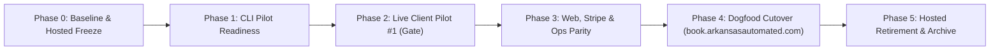

# PRD: Combining Hosted `aa-book` and Installable `AA-Agent` into One AA Book Product

- **Target Repository:** `andrebrassfield/AA-Agent` (`aabook` CLI, TypeScript on Bun)
- **Read-Only Source Mapped:** `andrebrassfield/aa-book` (`main` @ `5da6ef5`, Next.js 16 + Prisma + PostgreSQL 18 behind `book.arkansasautomated.com`) — full evidence-labeled inventory in [`./aa-book-map.md`](./aa-book-map.md)
- **CLI Baseline Verified:** `andrebrassfield/AA-Agent` (`main` @ `51c0ad6`) — architecture map in [`../../README.md`](../../README.md), guardrails in [`../../SPEC.md`](../../SPEC.md), open v1 limits in [`../../ROADMAP.md`](../../ROADMAP.md)
- **Explicitly Out of Scope:** `ArkansasAutomated/nsi-book` and `ArkansasAutomated/riverlocal-book` (not opened, cloned, or reasoned from)
- **Status:** Proposed — Ready for Owner Review

---

## Standing Rules (Non-Negotiable Constraints)

Every section of this PRD honors three standing rules set by the owner:

1. **Hosted stays live and untouched first:** `book.arkansasautomated.com` (`andrebrassfield/aa-book`) remains live, unmodified, and serving real traffic until the installable CLI (`AA-Agent`) proves itself at a real paying client pilot.
2. **The CLI is the future product form:** AA Book's long-term shape is `andrebrassfield/AA-Agent` — a per-client install on an always-on shop machine (or dedicated single-client box), configured via `client/*.json` files rather than per-client code forks or a shared multi-tenant database, running its own swappable `EngineAdapter` harness and `ProviderRouter` with hard spend caps.
3. **Phased convergence with gates, never a big-bang merge:** We do **not** copy Next.js, Prisma, or 42 PostgreSQL RLS tables into `AA-Agent`, and we do **not** retire any hosted surface until its replacement in `AA-Agent` is built, tested, and proven in production.

> **Verification labels:** Where this PRD cites current repo facts, **`[C]`** means confirmed directly in code/schema/tests, **`[I]`** means inferred from repo docs/comments/naming, and **`[U]`** means unknown without owner confirmation or live production inspection (indexed to `U-1`–`U-12` in [`./aa-book-map.md#10-unknowns-requiring-owner-or-live-system-inspection-u`](./aa-book-map.md#10-unknowns-requiring-owner-or-live-system-inspection-u)).

---

## 1. Combined Product Definition (Plain Language)

### What AA Book Is
**AA Book (`aabook`)** is Arkansas Automated's front-desk intake and booking system for home-services contractors (HVAC, plumbing, electrical, garage doors, inspections, exterior cleaning) and appointment businesses.

When a homeowner or a machine caller (such as Google's *"Have AI get prices"*) reaches a shop by **phone call, text message, or web booking link**, AA Book:
1. **Answers or texts back missed calls immediately** in the shop's own voice, disclosing honestly that it is the shop's AI assistant whenever asked.
2. **Quotes only owner-verified prices** from a fail-closed price book — never guessing or inventing an estimate.
3. **Checks real calendar availability, zip/drive-time coverage, and buffers**, then books, reschedules, or cancels appointments — whether the customer prefers talking on the phone, texting back and forth, or clicking a self-service web slot picker.
4. **Collects optional booking deposits or ticket payments** straight into the shop's own Stripe account when a service requires one.
5. **Chases open estimates automatically** (day 2, day 5, day 10) and **stops the instant the customer replies or calls**.
6. **Sends confirmations, reminders, self-service cancel/reschedule links, and post-job Google review asks**, while enforcing CTIA `STOP`/`START`/`HELP` SMS compliance and quiet hours.
7. **Keeps every shop isolated:** one install per client (`client/*.json` + local `data/aabook.sqlite` + `.env` secrets), zero shared multi-tenant database, predictable daily AI spend caps (`ProviderRouter`), and one-command local encrypted backups.

### What Was Tangled Together in Hosted `aa-book` (Product vs. Founder GTM Tools)
Mapping `andrebrassfield/aa-book` (`486` files, `42` tables, `78` API routes `[C]`) revealed that the hosted repo currently bundles **two different jobs** inside one multi-tenant Next.js app:

1. **Front-desk booking & intake capabilities that belong in the combined AA Book product:**
   - Public slot-picking & self-service cancel/reschedule capability links (`/book/[slug]`, `/manage/[bookingId]/*`) `[C]`
   - Two-way Google Calendar conflict checking (`freeBusy`), event CRUD, Meet links, and double-booking locks (`BookingOccupancy`) `[C]`
   - Stripe Checkout payment/deposit collection, webhook settlement, and cancellation refunds `[C]`
   - Fail-closed structured Trade Price Book (`ServicePrice`) for human and machine intake `[C]`
   - Returning-caller phone lookup with VIP and DNC (`reject: true`) handling for Retell inbound calls `[C]`
   - Optional confirmation/reminder email delivery (Resend/SMTP) and optional route-aware drive-time checks (Mapbox) `[C]`

2. **Arkansas Automated's own internal sales/marketing tools (NOT part of a contractor's front-desk install):**
   - Outbound cold-lead CRM kanban pipelines (`/pipelines`), sales dial queue (`/call-queue`), and `LEAD_DIAL` outreach emails `[C]`
   - "AA Letter" email newsletter composer and subscriber broadcast (`/letter`, `/subscribe`) `[C]`
   - LinkedIn and X social-media post scheduler (`/social`) `[C]`
   - Multi-tenant public SaaS self-signup (`/signup`), workspace switching, and 5-role PostgreSQL RLS machinery `[C]`

**Core product boundary:** The combined AA Book product absorbs Group 1 as lightweight, config-driven capabilities inside `andrebrassfield/AA-Agent` (`Bun.serve` + `bun:sqlite`), and **deliberately leaves Group 2 out of client shop installs** (see Open Decision #4 for where AA's own founder CRM/newsletter lives when `aa-book` eventually retires).

---

## 2. Phase 2 Comparison: Parity and Gap Table

All counts and behaviors below are verified against `andrebrassfield/aa-book` @ `5da6ef5` ([`./aa-book-map.md`](./aa-book-map.md)) and `andrebrassfield/AA-Agent` @ `51c0ad6` ([`../../README.md`](../../README.md)).

### 2.1 Hosted `aa-book` Has — CLI `AA-Agent` Lacks

| Capability | Hosted `aa-book` (`[C]`) | CLI `AA-Agent` Today (`[C]`) | Impact on Combined Product |
| :--- | :--- | :--- | :--- |
| **Public web booking page** | `/book/[slug]` + `/confirmation` + funnel `/f/[slug]`; custom questions (`TEXT`/`TEXTAREA`/`SELECT`/`CHECKBOX`); multi-duration tiers (`EventDuration`); brand colors/logo (`WorkspaceBranding`) | None (`Bun.serve` exposes `/health` and `4` webhook paths only; `0` HTML pages) | **Required client-facing gap.** Homeowners coming from a website, Google Business Profile "Book" button, or workshop CTA need a click-to-book page, not phone/SMS only. |
| **Customer self-service cancel/reschedule links** | `/manage/[bookingId]/cancel` & `/reschedule` backed by one-use HMAC `BookingCapability` tokens + `BookingManageSession` cookies + `/bookings/manage-link` recovery | Cancel/reschedule works by SMS or voice conversation only; no self-service web link | **High-value parity item.** Lets customers reschedule from a confirmation SMS/email in 2 taps without calling. |
| **Payment & deposit collection** | Live Stripe Hosted Checkout (`payments.ts`), `/api/webhooks/stripe` signature + `WebhookEvent` dedupe, session expiry, full/partial refunds, `CHECKOUT_CHASE` | `client/policies.json` defines `deposit: { required, type, amount }` and `services.json` defines `price`, **but zero Stripe/payment execution code exists** | **Required for paid workshops & shop deposits.** Needed before paid event types (e.g. `front-desk-workshop`) or trip-fee deposits can run on CLI. |
| **Event QR tickets** | `/ticket/[bookingId]` + `/api/public/ticket/[bookingId]/qr.png` (`qrcode` package) | None | Needed only for ticketed classes/workshops (such as AA's own workshop `[I]`), optional for trade shops. |
| **Fail-closed Trade Price Book** | `ServicePrice` table (`trade`, `service`, `serviceDetail`, `workKind`, `fixture`, `locationInHome`, `propertyType`, `timing`, `postalCode` → `cents`, `unit`, `source`) + fail-closed `lookupServicePrice` (`200` / `404 no_price` / `409 ambiguous_price`) | Flat `client/services.json` array (`id`, `name`, `price`, `durationMinutes`, `bufferMinutes`) | **Important for machine intake.** Contractors often quote ranges or fixture-specific prices and must fail closed rather than guessing when a caller asks about an unlisted job. |
| **Transactional email notifications** | Durable `EmailOutbox` (`11` kinds) over Resend HTTP or SMTP (`nodemailer`), including `BOOKING_CONFIRMED`, `BOOKING_RESCHEDULED`, `BOOKING_CANCELLED`, and T-15m `BOOKING_REMINDER` | SMS-only (`TwilioSmsProvider`); zero email sending | **Needed for workshops/B2B & optional for shops** whose customers want email calendar invites (`.ics`) alongside SMS. |
| **Route-aware drive-time & polygon coverage** | Mapbox forward geocoding + driving matrix (`RouteCache`), `RADIUS`/`POLYGON`/`ZIPLIST` service areas, `maxDriveMinutes`, multi-tech `maxDailyJobs` | Static `primaryZipCodes` list + `maxDistanceMiles` number in `client/policies.json`; no geocoding or drive-time matrix | **Optional Phase 3+ module** for multi-truck mobile trades where ZIP lists alone allow cross-town back-to-back bookings. |
| **Browser UI for shop owner** | `17` Next.js `(dashboard)` pages (Bookings, Availability, Contacts, Overview, Settings, etc.) + CSV export | Terminal CLI commands only (`aabook status`, `aabook usage`) | Non-technical shop owners need visibility (daily SMS/email digest and/or lightweight local read-only web dashboard). |
| **CRM Kanban, Cold Call Queue, Newsletter, Social Scheduler** | `/pipelines`, `/desk`, `/call-queue`, `/letter`, `/social` (`11` tables, LinkedIn/X OAuth, Telegram lead alert) | None | **Out of scope for client shop installs** (AA internal GTM tools; see Open Decision #4). |

### 2.2 CLI `AA-Agent` Has — Hosted `aa-book` Lacks

| Capability | CLI `AA-Agent` (`[C]`) | Hosted `aa-book` (`[C]`) | Why CLI Leads Here |
| :--- | :--- | :--- | :--- |
| **One-command per-client install & OS service** | `./bin/aabook.js install`, `aabook install --service` (`launchd` / `systemd`), `2` runtime npm packages on Bun, single `data/aabook.sqlite` file | Heavy multi-container deploy: Node 24 + Next.js + separate `dist/worker.mjs` + PostgreSQL 18 + 5 DB roles + 40+ env vars | Eliminates shared multi-tenant blast radius; each shop owns its machine and data. |
| **Client-as-config (`client/*.json`) + Templates + Wizard** | `6` validated JSON files + `router.json`, secret-in-config blocker (`validator.ts`), `aabook setup` interactive wizard, `templates/{blank,fort-smith-hvac,home-inspection}` | Web `/signup` + 1-card `/onboarding` confirm screen; configuration scattered across 10+ DB tables via manual browser forms | New client onboarding is copying a trade template, filling `TODO:`s with the owner, and running `aabook status`. |
| **Swappable Agent Harness (`EngineAdapter`)** | `CoreEngine` (default TS loop), `PiEngine` (`pi` + stdio MCP `manageBooking` tool server), `OmpEngine` (`omp-agent` stdio with timeout & `SIGKILL`) | **Zero runtime AI/agent execution** | Product workflows stay decoupled from any single agent runtime. |
| **Multi-provider LLM Router & Hard Spend Caps** | `ProviderRouter` across OpenAI/OpenRouter/NVIDIA NIM, Anthropic, and Gemini; `conversation` / `reasoning` / `aux` tiers; `model_usage` ledger; `aabook usage`; degrades `aux` first at `dailySpendCapUsd` | None | Protects unit economics per client install without ever dropping a live customer conversation. |
| **Live Voice Booking & Tool Execution** | `RetellVoiceAdapter` handling `POST /webhooks/voice` lifecycle events + `POST /webhooks/voice/tools` (`check_availability`, `book_appointment`, `reschedule`, `cancel`, `ask_agent`) + honest AI disclosure | Inbound caller-lookup webhook (`POST /api/voice/retell-inbound`) returning `dynamic_variables` only — **cannot check slots or book** | CLI actually completes bookings, reschedules, and cancellations mid-call. |
| **Two-Way SMS + Missed-Call Text-Back + 10DLC Compliance** | `TwilioSmsProvider` + signed `POST /webhooks/twilio/sms` (`X-Twilio-Signature`) + `missed_call.ts` text-back (`missed_call_dedupe`) + `STOP`/`START`/`HELP` (`sms_opt_outs`) | **Zero SMS support** | Missed-call text-back and text-to-book are core value drivers for contractors in the field. |
| **Automated Estimate Chasing & Post-Job Review Asks** | `estimate.ts` (day 2 / day 5 / day 10 touches, auto-stop on any call or SMS reply), `review.ts` (post-job Google review link), `FollowUpDispatcher` honoring `quietHours` | None (only 15-min pre-meeting email reminder + abandoned Stripe `CHECKOUT_CHASE`) | Directly generates recovered jobs and Google reviews for home-services clients. |
| **Offline End-to-End Verification & Local Encrypted-Safe Backup** | `aabook demo` (zero-key full workflow + local HTTP webhook proof in <1s) and `aabook backup` / `restore` (`VACUUM INTO` + USTAR `.tar.gz`, `.env` excluded) | Local demo requires `.env.local`, Prisma generate (×2), SQLite migrate + seed + Next server; prod backup is manual Windows PowerShell (`backup-postgres.ps1`) | Every PR and on-site install verifies deterministically offline in seconds. |

### 2.3 Both Have — In Different Forms (Must Converge)

| Area | Hosted `aa-book` Form (`[C]`) | CLI `AA-Agent` Form (`[C]`) | Target Combined Form in `AA-Agent` |
| :--- | :--- | :--- | :--- |
| **Google Calendar** | OAuth 2.0 PKCE (`googleapis`), two-way (`freebusy` + `insert`/`patch`/`delete` + ETag CAS + Meet links) | Service-account RS256 JWT over `fetch` (`GoogleCalendarAdapter`), **one-way `POST` create only** (`listBusySlots` is in-memory; no remote `PATCH`/`DELETE` yet) | Keep CLI's zero-SDK `fetch` adapter, upgrade it to **full two-way sync** (`freeBusy` busy-block reads + stored `externalCalendarEventId` for `PATCH`/`DELETE` + optional OAuth refresh-token mode alongside service-account mode). |
| **Retell Voice** | Caller lookup (`caller-lookup.ts`): normalizes E.164, checks returning customer + VIP + `dnc` (`reject: true`), returns `dynamic_variables` (no email leak) | Lifecycle + booking tool server (`retell.ts`): missed-call trigger, availability/book/reschedule/cancel tools | **Unify both in `RetellVoiceAdapter`:** serve inbound caller-lookup (`dynamic_variables` + DNC/VIP) on call start *and* execute tool calls + missed-call SMS text-back on call end, verified by `X-Retell-Signature`. |
| **Slot & Concurrency Model** | Email-keyed `Booking` + per-minute `BookingOccupancy` unique constraint + `AvailabilityInterval` + `AvailabilityOverride` | Phone-keyed `bookings` (`customerPhone`, optional email missing today) + `business.json` weekday hours + SQLite overlap check | Extend CLI `bookings` schema with optional `customerEmail`, `externalCalendarEventId`, `paymentStatus`, `manageTokenHash`, `priceSnapshotCents`, plus SQLite `BEGIN IMMEDIATE` transaction slot-overlap guard and date overrides in `client/business.json`. |
| **Background Queue** | Separate `dist/worker.mjs` process polling `IntegrationOutbox` + `EmailOutbox` + `WorkerHeartbeat` | In-process `FollowUpDispatcher` inside `aabook serve` (`pending → claimed → sent` in `scheduled_followups`) | Single-process `aabook serve` daemon running `FollowUpDispatcher` + durable `outbox_effects` retry table (for calendar/email retries) with SQLite heartbeat reported on `GET /health`. |

### 2.4 Neither Has Yet — Combined Product Needs

1. **Zero-Next.js Public Booking & Self-Service Manage Pages in `aabook serve`:** Server-rendered HTML/CSS routes (`GET /book/:slug`, `POST /book/:slug`, `GET /manage/:token`) served directly by `Bun.serve` from `client/*.json` + `data/aabook.sqlite` — mobile-fast, accessible, zero React build pipeline required.
2. **Automated HTTPS Ingress Helper (`aabook tunnel` / service integration):** Guided setup and health check for Cloudflare Named Tunnel (`cloudflared`) or Tailscale Funnel so a client box exposes `PUBLIC_WEBHOOK_BASE_URL` cleanly for Twilio, Retell, Stripe, and `/book/:slug`.
3. **Per-Client Fleet Support, Health Heartbeat & Safe Updates (`aabook doctor`, `aabook upgrade`):** Hosted had shared DB visibility; CLI installs sit on separate client machines. Combined product needs:
   - `aabook doctor` producing a secret-redacted diagnostic bundle (config validity, SQLite WAL health, queue backlog, calendar/Twilio/Retell reachability, tunnel check, spend vs cap).
   - Optional outbound dead-man's-switch heartbeat (`HEARTBEAT_PING_URL` in `.env`, e.g., Healthchecks/AA monitor receiving *only* `{ clientSlug, version, status, pendingFollowups }` — zero PII) so Dre knows within 5 minutes if a client's shop loses power or internet.
   - `aabook upgrade` that runs `aabook backup` automatically, pulls a pinned release tag, runs `bun test` / schema check, restarts the `launchd`/`systemd` unit, and rolls back on `/health` failure.
4. **Shop Owner Visibility Without Terminal Access:** Daily morning SMS/email digest to the shop owner ("Yesterday: 6 calls, 3 booked, 2 missed-call saves, 1 estimate follow-up replied") plus an optional localhost/token-gated read-only Owner Summary page on `aabook serve`.
5. **Deterministic Hosted-to-CLI Data Exporter/Importer (`aabook import-hosted`):** Validated migration tool mapping a single hosted `Workspace` from `aa-book` into `client/*.json` + `data/aabook.sqlite` + read-only historical archive.

---

## 3. Target Architecture for the Combined Repo (`andrebrassfield/AA-Agent`)

### 3.1 Proposed Repository Layout

`andrebrassfield/AA-Agent` remains a single Bun + TypeScript package with near-zero runtime dependencies (no Next.js, no Prisma, no PostgreSQL, no Docker requirement for client installs).

```text
AA-Agent/
├── bin/
│   └── aabook.js                 # Bun >= 1.1.0 guard & CLI entrypoint
├── src/
│   ├── index.ts                  # CLI command router
│   ├── cli/
│   │   ├── install.ts            # One-command install + launchd/systemd service
│   │   ├── setup.ts              # Interactive client/*.json wizard
│   │   ├── status.ts             # Config + SQLite + outbox + tunnel health summary
│   │   ├── usage.ts              # Read-only model token & USD spend ledger
│   │   ├── backup.ts             # Atomic VACUUM INTO + USTAR .tar.gz backup/restore
│   │   ├── doctor.ts             # [NEW] Redacted support diagnostics + live connectivity probe
│   │   ├── upgrade.ts            # [NEW] Auto-backup + pinned git tag upgrade + health rollback
│   │   └── import_hosted.ts      # [NEW] Deterministic importer from aa-book workspace export
│   ├── config/
│   │   ├── loader.ts             # Loads business, services, price_book, staff, persona, policies, channels, router
│   │   └── validator.ts          # Schema + TODO + secret-key guards
│   ├── calendar/
│   │   └── calendar.ts           # Two-way GoogleCalendarAdapter (SA JWT or OAuth refresh) + FakeCalendar + .ics builder
│   ├── channels/
│   │   ├── coordinator.ts        # Unified voice + SMS + web booking turn coordinator
│   │   ├── registry.ts           # Voice/SMS/Email/Payment provider registry
│   │   ├── voice/
│   │   │   ├── retell.ts         # Inbound caller-lookup (DNC/VIP) + X-Retell-Signature + tool calls
│   │   │   └── elevenlabs.ts     # [ROADMAP] ElevenLabs Conversational AI adapter
│   │   ├── sms/
│   │   │   ├── twilio.ts         # Live Twilio REST + X-Twilio-Signature + 10DLC STOP/START/HELP
│   │   │   ├── compliance.ts     # CTIA keyword classifier
│   │   │   └── stub.ts           # Offline stub
│   │   └── email/
│   │       └── email.ts          # [NEW] Optional Resend HTTP / SMTP transactional email + stub
│   ├── payments/
│   │   └── stripe.ts             # [NEW] Optional Stripe Checkout deposit/ticket adapter + /webhooks/stripe HMAC + stub
│   ├── routing_geo/
│   │   └── drive_time.ts         # [NEW, optional] Mapbox drive-time / polygon check when enabled in policies.json
│   ├── engine/                   # EngineAdapter: CoreEngine, PiEngine, OmpEngine (unchanged contract)
│   ├── mcp/                      # Stdio MCP booking tool server
│   ├── router/                   # ProviderRouter + OpenAI/Anthropic/Gemini HTTP + spend caps
│   ├── workflows/
│   │   ├── booking.ts            # Unified slot/buffer/override/calendar/deposit booking workflow
│   │   ├── price_book.ts         # [NEW] Fail-closed ServicePrice lookup ported from aa-book
│   │   ├── missed_call.ts        # Missed-call SMS text-back
│   │   ├── estimate.ts           # Day 2 / 5 / 10 estimate follow-up with reply-stop
│   │   ├── review.ts             # Post-job Google review request
│   │   └── dispatcher.ts         # FollowUpDispatcher + durable outbox retries + optional heartbeat ping
│   ├── web/                      # [NEW] Server-rendered HTML/JSON public surfaces on Bun.serve
│   │   ├── public_book.ts        # GET/POST /book/:slug, /book/:slug/slots, /book/:slug/confirmation, /f/:slug
│   │   ├── public_manage.ts      # GET/POST /manage/:token (HMAC capability cancel/reschedule) & /ticket/:token
│   │   └── owner_desk.ts         # Localhost / token-gated read-only Shop Owner summary & CSV export
│   ├── server/
│   │   ├── server.ts             # Bun.serve routing webhooks + /health + optional src/web/* surfaces
│   │   └── redact.ts             # Secret & PII log redaction
│   └── db/
│       └── store.ts              # bun:sqlite DataStore (WAL mode, BEGIN IMMEDIATE slot lock, migrations)
├── templates/                    # blank, fort-smith-hvac, home-inspection (+ arkansas-automated dogfood pack)
├── scripts/
│   └── export-hosted-workspace.mjs # [NEW] Read-only exporter run against aa-book SQLite/PG dump -> JSON bundle
├── docs/
│   └── combined-prd/
│       ├── PRD.md                # This document
│       └── aa-book-map.md        # Phase 1 hosted inventory
└── tests/                        # Unit + integration + fake-carrier/fake-stripe/public-web suites
```

### 3.2 Disposition of Every Hosted `aa-book` Piece

Nothing from `aa-book` is copied blindly. Every hosted subsystem has an explicit architectural home or retirement rule:

| Hosted `aa-book` Subsystem (`[C]`) | What It Becomes in the Combined Architecture | Where It Lives |
| :--- | :--- | :--- |
| **Public booking UI (`/book/[slug]`, `/f/[slug]`, `/uppity-ai/[slug]`)** | Rebuilt as fast, zero-React-bundle server-rendered HTML + progressive form endpoints (`public_book.ts`) reading `client/business.json` + `client/services.json`, gated per client by `channels.json` (`webBooking.enabled`). Legacy `/uppity-ai/:slug` 301-redirects when configured. | `src/web/public_book.ts` |
| **Invitee capability links (`/manage/[bookingId]/*`)** | Port the HMAC capability-token pattern (`read`/`cancel`/`reschedule` scopes, hashed in SQLite) so SMS and email confirmations carry a 2-tap self-service link. | `src/web/public_manage.ts` + `src/db/store.ts` |
| **Workshop QR tickets (`/ticket/[bookingId]`, `/qr.png`)** | Optional lightweight ticket + SVG QR endpoint enabled only on services with `"ticketQr": true` in `client/services.json`. | `src/web/public_manage.ts` |
| **Two-way Google Calendar + Meet (`calendar.ts`)** | Upgrade `GoogleCalendarAdapter` (`src/calendar/calendar.ts`) with `freeBusy` reads, `externalCalendarEventId` storage, `PATCH`/`DELETE` on reschedule/cancel, and optional `conferenceDataVersion=1` Meet creation. | `src/calendar/calendar.ts` |
| **Per-minute `BookingOccupancy` lock** | Replaced in single-tenant SQLite by `BEGIN IMMEDIATE` write transactions + indexed `(startTime, endTime)` overlap check in `DataStore` (single SQLite writer eliminates cross-process races without 60 rows per hour). | `src/db/store.ts` |
| **Stripe Checkout + refunds (`payments.ts`)** | Re-implemented over Bun `fetch` (`https://api.stripe.com/v1/...`, zero `stripe` npm SDK needed) + WebCrypto `Stripe-Signature` HMAC verification + SQLite webhook dedupe. Uses each client's own `STRIPE_SECRET_KEY` in `.env`. | `src/payments/stripe.ts` |
| **Retell caller lookup (`caller-lookup.ts`)** | Port E.164 phone normalization, returning-caller context, VIP flag, and DNC (`reject: true`) directly into `RetellVoiceAdapter` inbound handler. | `src/channels/voice/retell.ts` + `src/db/store.ts` |
| **Trade Price Book (`ServicePrice` + ADR 0001)** | Port fail-closed specificity matcher (`200` match / `no_price` / `ambiguous_price`) into `src/workflows/price_book.ts`, backed by `client/price_book.json` (versioned config, validated for non-empty `cents` + `unit` + `source`), exposed as an agent tool for voice, SMS, and machine intake. | `src/workflows/price_book.ts` + `src/config/validator.ts` |
| **Email Outbox (`notifications.ts` — Resend/SMTP)** | Optional `EmailProvider` (`Resend` via `fetch` primary) queued through `scheduled_followups` / `outbox_effects` for booking confirmations, T-24h / T-15m reminders, `.ics` attachments, and owner daily digests. | `src/channels/email/email.ts` |
| **Route-aware Mapbox drive time (`mapbox.ts`, `routing.ts`)** | Optional module activated only when `policies.json` sets `"routing": { "mode": "drive_time", "maxDriveMinutes": 20 }` and `MAPBOX_SECRET_TOKEN` is in `.env`; defaults to zero-API ZIP list check. | `src/routing_geo/drive_time.ts` |
| **Multi-tenant Auth, `/signup`, RBAC, PostgreSQL 18 + 5-role RLS (`49` policies)** | **Retired with `aa-book` in Phase 5.** Per-client CLI installs are single-tenant by physical/process isolation; there is no public `/signup`. | *Not carried forward* |
| **CRM Pipelines, Call Queue, AA Letter Newsletter, LinkedIn/X Social Engine** | **Excluded from client `aabook` runtime.** Either archived after export or spun out to Dre's internal GTM workspace if still actively used (Open Decision #4). | *Not carried forward into `AA-Agent`* |

---

## 4. Phased Convergence Plan (With Gates and Proofs)

**Cardinal rule:** Hosted `book.arkansasautomated.com` stays untouched through Phases 0, 1, 2, and 3. No hosted piece is retired until its CLI replacement has passed its exit proof in real usage.



### Phase 0 — Baseline, Decisions & Hosted Freeze
- **Entry Gate:** This PRD (`PR #10`) reviewed by owner; Open Decisions #1–#8 resolved; Unknowns `U-1`–`U-12` answered via a 15-minute read-only owner check of Railway/Stripe/Retell.
- **Deliverables:**
  1. Hosted `andrebrassfield/aa-book` remains in strict maintenance freeze (critical security/outage fixes only; zero new feature branches).
  2. Document live baseline metrics from owner check (`U-1`–`U-12`) in `docs/combined-prd/` follow-up note.
- **Exit Proof:** Written owner sign-off on Open Decisions + confirmed inventory of active URLs/workshops on `book.arkansasautomated.com` that Phase 4 must preserve.

### Phase 1 — CLI Pilot-Readiness (Voice + SMS + Two-Way Calendar + Price Book)
- **Entry Gate:** Phase 0 exit proof complete.
- **Deliverables (in `andrebrassfield/AA-Agent`):**
  1. **Two-way Google Calendar sync** (`src/calendar/calendar.ts`): `freeBusy` external busy-slot query in `listBusySlots`, persist `externalCalendarEventId` on `bookings`, remote `PATCH`/`DELETE` on reschedule/cancel, plus SQLite `BEGIN IMMEDIATE` overlap lock.
  2. **Unified Retell inbound + security** (`src/channels/voice/retell.ts`): native `X-Retell-Signature` HMAC verification, plus returning-caller / VIP / DNC (`reject: true`) lookup ported from `aa-book`'s `caller-lookup.ts`.
  3. **Fail-closed Trade Price Book** (`src/workflows/price_book.ts` + `client/price_book.json`): port `aa-book` ADR-0001 specificity rules (`exact match` / `no_price` / `ambiguous_price`) into voice & SMS tool calls so machine callers ("Google Have AI get prices") and homeowners never get a guessed number.
  4. **On-site ops kit** (`src/cli/doctor.ts` + tunnel guide/script + optional `HEARTBEAT_PING_URL` dead-man's-switch ping + daily owner SMS summary).
- **Exit Proof:** `bun test && bun run check && aabook demo` green; fake-carrier + fake-Google-Calendar + fake-Retell signed-webhook integration suites pass; `aabook doctor` passes on a clean staging box over a real HTTPS tunnel (Cloudflare Tunnel or Tailscale Funnel). *Hosted `aa-book` remains 100% untouched.*

### Phase 2 — First Live Paying Client Pilot (The Standing-Direction Gate)
- **Entry Gate:** Phase 1 exit proof complete + pilot client's Twilio A2P 10DLC Brand/Campaign approved, Retell number provisioned, Google Calendar shared, and owner-verified `client/*.json` (`0` `TODO:` placeholders).
- **Deliverables:**
  1. On-site or dedicated single-tenant install of `aabook` (`aabook install --service`) at Pilot Client #1.
  2. `30` consecutive days of live production operation handling real inbound calls, missed-call text-backs, SMS bookings, Google Calendar sync, estimate follow-ups, and daily spend-cap routing.
- **Exit Proof (Hard Gate before any convergence/cutover work touches hosted traffic):**
  - `>= 30` days live at Pilot Client #1 with **zero** double-bookings, **zero** `STOP` compliance violations, **zero** secret leaks, and `100%` of days within `dailySpendCapUsd`.
  - At least `1` real voice booking, `1` missed-call text-back conversation, `1` reschedule/cancellation reflected in Google Calendar, and `1` backup-and-restore drill verified on a scratch directory.
  - Explicit owner **GO** that the CLI form has proven out. *Hosted `book.arkansasautomated.com` has remained completely untouched to this point.*

### Phase 3 — Web Booking, Stripe Deposits, Email & Fleet Upgrade Parity in `AA-Agent`
- **Entry Gate:** Phase 2 pilot gate signed off by owner.
- **Deliverables (in `andrebrassfield/AA-Agent`):**
  1. **Public Web Booking & Funnel Routes (`src/web/public_book.ts`):** `GET/POST /book/:slug`, `/book/:slug/confirmation`, `/f/:slug` (and configurable legacy redirects such as `/uppity-ai/:slug`), custom intake questions, buffers/minimum-notice/booking-window rules, WCAG-checked brand accent from `business.json`.
  2. **Self-Service Capability Links & Optional QR Tickets (`src/web/public_manage.ts`):** `/manage/:token` cancel & reschedule + optional `/ticket/:token` QR pass.
  3. **Stripe Checkout / Deposit Adapter (`src/payments/stripe.ts`):** Bun `fetch` Stripe Checkout Session creation when a service has `price > 0` or `deposit.required = true`, `POST /webhooks/stripe` signature verification + SQLite dedupe, cancellation refund option, and unpaid-checkout expiry/chase via `FollowUpDispatcher`.
  4. **Optional Transactional Email (`src/channels/email/email.ts`) + Owner Desk (`src/web/owner_desk.ts`) + `aabook upgrade` (`src/cli/upgrade.ts`).**
  5. **Hosted Migration Tooling:** `scripts/export-hosted-workspace.mjs` + `aabook import-hosted` tested against a seeded `aa-book` SQLite/Postgres fixture.
- **Exit Proof:** Full integration suite covering free & Stripe-paid web booking, capability-link reschedule/cancel + refund, email + `.ics` generation, QR ticket rendering, `aabook import-hosted` dry-run reconciliation (`0` lost bookings/contacts), and `aabook upgrade` simulated failure auto-rollback.

### Phase 4 — Migrate `book.arkansasautomated.com` (Arkansas Automated Dogfood Cutover)
- **Entry Gate:** Phase 3 exit proof complete + owner answers to `U-2`, `U-7`, `U-10` confirm all active slugs/integrations on `book.arkansasautomated.com`.
- **Deliverables:**
  1. Take an encrypted read-only snapshot of Railway PostgreSQL; run `export-hosted-workspace.mjs` → `aabook import-hosted` into AA's dedicated single-tenant `aabook` instance (`templates/arkansas-automated/` or AA's production config).
  2. Stand up AA's `aabook` instance on a staging subdomain (e.g., `book-next.arkansasautomated.com`) and verify live end-to-end parity: `/book/front-desk-workshop` ($ ticket + Stripe Checkout test/live), `/book/fit-assessment`, `/uppity-ai/*` redirects, Google Calendar + Meet link creation, Retell caller lookup, and existing invitee `/manage/*` + `/ticket/*` links.
  3. Lower DNS TTL on `book.arkansasautomated.com` to `60s`, run final delta export/import during a low-traffic window, add Stripe/Retell webhook endpoints to the new instance, and flip `book.arkansasautomated.com` to AA's `aabook` instance.
  4. **Keep Railway `aa-book` running warm (read-only / standby) for 14 days** for instant `<5 min` DNS rollback if needed.
- **Exit Proof:** `14` days of clean live traffic on `book.arkansasautomated.com` served by `AA-Agent` (`0` 5xx errors, real booking + calendar + email + Stripe webhook verified, `0` unserved legacy URLs).

### Phase 5 — Ordered Retirement & Archival of `andrebrassfield/aa-book`
- **Entry Gate:** Phase 4 `14`-day soak passed with zero rollback triggers + owner confirms zero open Stripe disputes/pending outbox items on old Railway DB.
- **Deliverables:** Execute the ordered retirement sequence in §6 below, store final encrypted archival dump + JSONL export, tear down Railway `loyal-passion` services, and archive `andrebrassfield/aa-book` on GitHub (read-only).
- **Exit Proof:** `book.arkansasautomated.com/health` returns `200` from `AA-Agent`; Railway bill for `aa-book` is `$0`; `andrebrassfield/aa-book` shows `archived: true` on GitHub with a top-of-README pointer to `andrebrassfield/AA-Agent`.

---

## 5. Data Migration Story (`aa-book` PostgreSQL → `AA-Agent`)

### 5.1 Guiding Principles
1. **Read-only extraction:** `scripts/export-hosted-workspace.mjs` connects with `SELECT`-only credentials (or reads a local `pg_dump` restore) for a single target `workspaceId`. It never mutates `aa-book`.
2. **Config becomes JSON; operational history becomes SQLite; non-product tables become an immutable archive:** Nothing is silently dropped.
3. **Never migrate secrets or live OAuth ciphertexts:** `OAuthConnection`, `SocialProfile`, `AuthSession`, `AccountActionToken`, and `WorkspaceInvitation` hashes are **never** copied. Credentials are entered fresh into `.env` on the target `aabook` host.

### 5.2 Table-by-Table Mapping (`42` Hosted Models Accounted For)

| Hosted `aa-book` Models (`[C]`) | Target Destination in `AA-Agent` | Migration Rule |
| :--- | :--- | :--- |
| `Workspace`, `WorkspaceBranding`, `AvailabilitySchedule`, `AvailabilityInterval`, `AvailabilityOverride` (`5`) | `client/business.json` | Maps workspace name, timezone, brand accent/logo/footer, weekly intervals, and future date overrides. |
| `EventType`, `EventDuration`, `CustomQuestion` (`3`) | `client/services.json` | Maps active slugs (`fit-assessment`, `front-desk-workshop`), durations, ticket `priceCents`, buffers, minimum notice, window days, location type, custom questions, and `landingJson`. |
| `ServicePrice` (`1`) | `client/price_book.json` | 1:1 lossless export of active trade price rows (`trade`, `service`, `cents`, `unit`, `source`, filters). |
| `User`, `Membership`, `Technician` (`3`) | `client/staff.json` | Maps active hosts/technicians (`name`, `role`, `maxDailyJobs`). Password hashes (`scrypt`) are discarded. |
| `Address`, `ServiceArea`, `EventTypeServiceArea` (`3`) | `client/policies.json` | Extracts ZIP lists, radius miles, center coordinates, and `Workspace.maxDriveMinutes`. |
| `Booking`, `BookingAnswer`, `BookingCapability` (`3`) | `data/aabook.sqlite` → `bookings` (+ `booking_answers`) | Preserves booking `id`, invitee name/email/phone, `startTime`/`endTime`, `status`, `externalCalendarEventId` (so future reschedules update the *existing* Google Calendar event rather than duplicating it), Stripe IDs, and active capability token hashes (if same `BOOKING_CAPABILITY_SECRET` is configured during transition so emailed `/manage/*` links keep working). |
| `Contact`, `Lead` (DNC/VIP tags & open estimates) (`2`) | `data/aabook.sqlite` → `caller_contacts` & `estimates` & `sms_opt_outs` | Preserves customer name/phone/email, `dnc`/`vip` flags for caller lookup, and any explicitly flagged open service estimates. |
| `Pipeline`, `PipelineStage`, `LeadActivity`, `LeadTask`, `NewsletterIssue`, `SocialPost` (`6`) | `archive/<workspace>-crm-marketing.jsonl.gz` (and optional founder CRM export) | Losslessly exported to timestamped read-only JSONL archive alongside checksums; not loaded into contractor front-desk SQLite. |
| `AuthSession`, `AccountActionToken`, `WorkspaceInvitation`, `OAuthState`, `OAuthConnection`, `SocialProfile`, `BookingManageSession`, `BookingRecoveryToken`, `BookingOccupancy`, `IntegrationOutbox`, `EmailOutbox`, `LocalInboxMessage`, `WebhookEvent`, `RateLimitBucket`, `WorkerHeartbeat`, `RouteCache` (`16`) | Ephemeral / security-bound (`not migrated`; outbox checked for `0` `PENDING`/`DEAD` before cutover) | Pre-cutover check fails closed if `IntegrationOutbox` or `EmailOutbox` has `PENDING`/`RETRY`/`PROCESSING` rows for future bookings. |

### 5.3 Reconciliation Proof
`aabook import-hosted --verify` prints a deterministic manifest comparing source counts vs imported counts (`EventType` count, `ServicePrice` count, future `CONFIRMED` `Booking` count, `Contact` count, `DNC` tag count) and exits non-zero on any mismatch before traffic cutover is allowed.

---

## 6. Retirement Order & Rollback Triggers

No step below runs until **Phase 4's entry gate** is met (Pilot #1 proven in Phase 2 + parity built in Phase 3).

| Order | Piece Retired | Precondition | Rollback Trigger (During 14-Day Soak) | Rollback Action (`< 5 min`) |
| ---: | :--- | :--- | :--- | :--- |
| **1** | Hosted Retell inbound lookup (`/api/voice/retell-inbound` on Railway) | AA's `aabook` instance passes signed caller-lookup + voice-tool smoke call | Any failed inbound call, missing dynamic variable, or failed DNC reject (`>0` errors) | Repoint Retell `inbound_webhook_url` back to Railway `book.arkansasautomated.com` URL |
| **2** | Hosted public web & booking traffic (`book.arkansasautomated.com` DNS) | Staging parity verified on `/book/front-desk-workshop`, `/book/fit-assessment`, `/manage/*`, `/ticket/*`; outbox drained to `0` | Any double-booking, broken `/book/*` or `/manage/*` flow, calendar sync failure, or `>1%` 5xx over 15 min | Flip `book.arkansasautomated.com` DNS record (60s TTL) back to warm Railway service; replay any delta bookings created on CLI back to Google Calendar |
| **3** | Hosted Stripe webhook (`/api/webhooks/stripe` on Railway) | All open pre-cutover `cs_live_` Checkout sessions (`24h` max lifetime) have settled or expired | Any Stripe webhook `4xx`/`5xx` on `AA-Agent` `/webhooks/stripe` | Re-enable Railway webhook endpoint in Stripe Dashboard and click "Resend" on failed event IDs |
| **4** | Hosted dedicated worker (`dist/worker.mjs` on Railway) | `14` days after Step 2 with `0` `PENDING`/`RETRY` rows in Railway `IntegrationOutbox` & `EmailOutbox` | Discovery of queued reminder/refund still scheduled in Railway DB | Restart Railway worker process to drain remaining rows |
| **5** | Hosted Railway `@snagtime/web` & PostgreSQL (`loyal-passion`) | Step 4 complete + encrypted `pg_dump` + `export-hosted-workspace.mjs` JSONL archive verified by restore test onto local Postgres | Need to inspect historical CRM/newsletter record | Query local archived `pg_dump` / JSONL bundle (no live cloud restore needed) |
| **6** | GitHub repo `andrebrassfield/aa-book` active status | Step 5 complete + any wanted experimental branch diffs (`U-12`) cherry-picked or documented | None (`git` history remains permanently readable) | Unarchive repo on GitHub (`gh repo unarchive`) if ever needed |

---

## 7. Risks, Named Plainly

1. **Shop-box uptime vs. cloud uptime (Power, Wi-Fi, OS sleep, tunnel drops):** Hosted Railway runs in a datacenter; a Mac Mini or mini-PC in a contractor's office can be unplugged by a cleaner, lose ISP connectivity, or pause after an OS update. *Mitigation:* `launchd`/`systemd` auto-restart, energy-saver sleep disabled in `CLIENT-SETUP.md`, Cloudflare Named Tunnel auto-reconnect service, outbound 60-second `HEARTBEAT_PING_URL` dead-man's-switch alerting Dre on missed pings, and Retell fallback call-forwarding to the owner's cell if `/webhooks/voice` times out.
2. **Twilio A2P 10DLC & Carrier Vetting Lead Times (`7–21` days):** A pilot shop cannot send live US business SMS until Brand + Campaign vetting clears. If setup starts late, Pilot #1 stalls on carrier bureaucracy rather than software. *Mitigation:* Start 10DLC submission on Day 1 of client agreement; test everything against `StubSmsProvider` + voice first.
3. **One-way Google Calendar blind spot until Phase 1 lands:** Today (`51c0ad6`), CLI's `GoogleCalendarAdapter` creates events on Google Calendar (`POST`) **but does not read external `freeBusy` blocks** (`ROADMAP.md` #2 `[C]`). If a contractor adds a dentist appointment on their phone calendar, CLI v1 today would book over it. *Mitigation:* Two-way `freeBusy` + `PATCH`/`DELETE` is a hard **Phase 1 blocker** before Pilot #1 goes live.
4. **Breaking emailed `/manage/[bookingId]` links or in-flight Stripe checkouts during Phase 4 cutover:** Existing workshop registrants hold emails pointing to `https://book.arkansasautomated.com/manage/...` and `/ticket/...`. *Mitigation:* Preserve booking IDs + capability secret keyring in `aabook import-hosted`, wait `24h` for any open Stripe Checkout sessions to close, and test real pre-cutover links on staging before DNS flip.
5. **Multi-client fleet drift ("N snowflaked shop machines"):** Per-client installs prevent multi-tenant data leaks, **but** updating 15 client machines manually over SSH will drift fast. *Mitigation:* Strictly forbid per-client edits inside `src/` (enforced by clean `git status` check in `aabook status`/`doctor`), keep all customization in `client/*.json`, and ship `aabook upgrade` with pinned tags and automatic backup/rollback before Client #3.
6. **Scope pollution from hosted founder GTM features:** Porting `aa-book`'s 17-screen React dashboard, Kanban CRM, AA Letter newsletter, and LinkedIn/X social poster into `AA-Agent` would bloat a clean `10,000`-line Bun codebase (`[C]`) back into a mini-SaaS monolith. *Mitigation:* Enforce the product boundary in §1 — contractor front-desk workflows only in `AA-Agent`.
7. **Unknown live state on `book.arkansasautomated.com` (`U-1`–`U-12`):** Because `aa-book` was transferred from `ArkansasAutomated/aa-book` to `andrebrassfield/aa-book` `[C]`, Railway's GitHub deploy hook, Google OAuth's "Testing" 7-day token status (`U-8`), and whether any third-party workspace signed up via open `/signup` (`U-2`) are unverified until the owner checks Railway. *Mitigation:* Settle `U-1`–`U-12` in Phase 0 before planning Phase 4 dates.

---

## 8. Open Decisions for the Owner

Each decision lists the concrete options, the core tradeoff in one line, and a clear recommendation.

### 1. Where does a client's `aabook` instance run by default?
- **Options:** **(A)** On-premises mini-PC / Mac Mini at the client's shop; **(B)** Dedicated single-tenant cloud VM per client (e.g., $5–$10/mo Hetzner/Fly/Railway single-client box running the exact same `aabook` CLI + SQLite + `client/` folder); **(C)** Hybrid — same `aabook` codebase, owner chooses per client (shop hardware for data-local clients, isolated per-client VM for shops with flaky office Wi-Fi).
- **Tradeoff:** On-prem hardware maximizes local-data ownership and zero monthly cloud hosting, while a per-client cloud VM eliminates office power/Wi-Fi outages without reintroducing multi-tenant coupling.
- **Recommendation:** **(C) Hybrid (defaulting to per-client isolated VM or shop Mac Mini using the exact same `aabook` install + `launchd`/`systemd` unit)** — zero code difference, lets Dre pick reliability vs on-prem per shop.

### 2. How should public `/book/:slug` and `/manage/:token` web pages be served for CLI clients?
- **Options:** **(A)** Served directly by `Bun.serve` inside `aabook serve` over the client's HTTPS tunnel (`PUBLIC_WEBHOOK_BASE_URL`, e.g., `book.clientshop.com` via Cloudflare Named Tunnel); **(B)** Separate central multi-tenant Next.js web proxy talking back to client tunnels; **(C)** Skip public web booking for CLI clients and do phone/SMS only.
- **Tradeoff:** Serving lightweight server-rendered HTML directly from `Bun.serve` over the existing webhook tunnel adds zero extra infrastructure, whereas a central proxy reintroduces a shared multi-tenant SPOF and skipping web loses website/GBP click-to-book conversions.
- **Recommendation:** **(A) Serve server-rendered `/book/:slug` and `/manage/:token` directly from `Bun.serve`** over the same Cloudflare Named Tunnel already required for Twilio/Retell webhooks (gated by `webBooking.enabled` in `client/channels.json`).

### 3. How should Google Calendar authenticate per client in `AA-Agent`?
- **Options:** **(A)** Service Account JSON (`GOOGLE_CLIENT_EMAIL` + `GOOGLE_PRIVATE_KEY`, client shares calendar with the service account email — CLI's current pattern); **(B)** OAuth 2.0 refresh token (`GOOGLE_CLIENT_ID` + `GOOGLE_CLIENT_SECRET` + `GOOGLE_REFRESH_TOKEN` minted once during `aabook setup --google`); **(C)** Support both behind `CalendarAdapter` (Service Account default, OAuth refresh token fallback).
- **Tradeoff:** Service accounts never expire after 7 days and avoid Google OAuth app verification reviews, whereas some Workspace org policies block sharing external service accounts with calendars.
- **Recommendation:** **(C) Keep Service Account as the primary path (zero OAuth consent expiry) and add optional OAuth refresh-token support inside `GoogleCalendarAdapter`** for shops whose Google Workspace admin restricts external sharing.

### 4. What happens to `aa-book`'s non-booking founder tools (CRM Pipelines, Call Queue, AA Letter newsletter, LinkedIn/X Social Engine)?
- **Options:** **(A)** Do **not** port them into `AA-Agent`; export their data before Phase 5 retirement and either drop unused slices or keep a private founder-only GTM tool separate from `AA-Agent`; **(B)** Port CRM/newsletter/social into `AA-Agent`.
- **Tradeoff:** Keeping founder GTM tools out of `AA-Agent` keeps the contractor appliance small, auditable, and single-purpose, whereas porting them doubles surface area with features no HVAC/plumbing shop asked for.
- **Recommendation:** **(A) Keep CRM Call Queue, AA Letter, and Social Engine strictly out of `AA-Agent`** (confirm in `U-11` which, if any, Dre actively uses today; export all rows to JSONL before Phase 5).

### 5. How should client deposits and paid bookings work in `AA-Agent`?
- **Options:** **(A)** Optional direct Stripe Checkout adapter (`STRIPE_SECRET_KEY` + `STRIPE_WEBHOOK_SECRET` in each client's `.env`, money goes 100% directly to the shop's own Stripe account); **(B)** Static Stripe Payment Links pasted into `services.json` (no webhook/refund automation); **(C)** Stripe Connect platform owned by Arkansas Automated.
- **Tradeoff:** Direct per-client Stripe keys give full automated deposit confirmation and refund safety with zero platform money-transmitter liability, whereas Payment Links can't auto-confirm slots reliably and Stripe Connect adds platform compliance overhead.
- **Recommendation:** **(A) Direct per-client Stripe Checkout + `/webhooks/stripe` in `src/payments/stripe.ts`** (enabled only when a client has paid services or `deposit.required = true`).

### 6. Should Mapbox route-aware drive-time & polygon scheduling be ported to `AA-Agent`?
- **Options:** **(A)** Keep ZIP-code + flat buffer rules as the default for Pilot #1, and port Mapbox drive-time (`src/routing_geo/drive_time.ts`) as an **opt-in Phase 3+ add-on** only when a mobile multi-tech client needs it; **(B)** Require Mapbox geocoding for all bookings in Phase 1; **(C)** Drop drive-time routing permanently.
- **Tradeoff:** ZIP lists cover 90% of single-crew local trades with zero third-party geocoding failure modes, while multi-van mobile trades across spread-out rural counties genuinely benefit from drive-time caps.
- **Recommendation:** **(A) Default to zero-dependency ZIP-code filtering for Phase 1–2; port Mapbox drive-time only as an opt-in policy mode in Phase 3+.**

### 7. What visibility surface should non-technical shop owners get?
- **Options:** **(A)** Automated daily SMS/email digest + optional read-only Owner Summary web page (`GET /desk` on LAN or magic token) + Google Calendar event descriptions holding full call/booking context; **(B)** Full read/write multi-user React admin dashboard ported from `aa-book`; **(C)** CLI terminal only (`aabook status`).
- **Tradeoff:** Contractors already live in their calendar and text messages, so Calendar + Daily Digest + read-only summary delivers 95% of visibility at 5% of the maintenance cost of a full multi-user web admin suite.
- **Recommendation:** **(A) Put rich booking/caller notes onto the Google Calendar event, send a daily owner SMS/email digest, and expose a tiny read-only Owner Summary page.**

### 8. What happens to `andrebrassfield/aa-book` and its `35` feature branches once Phase 5 completes?
- **Options:** **(A)** Keep `andrebrassfield/aa-book` untouched during Phases 0–4, harvest any logic needed by reference (clean-room TypeScript in Bun), take a final encrypted DB + JSONL backup in Phase 5, and **archive `andrebrassfield/aa-book` read-only** (`gh repo archive`) rather than deleting it; **(B)** Merge `aa-book` git history into `AA-Agent` via subtree; **(C)** Delete `andrebrassfield/aa-book`.
- **Tradeoff:** Archiving `aa-book` preserves full commit/PR history, SnagTime MIT provenance, and all 35 experimental branches without polluting `AA-Agent`'s clean 80+ file Bun git tree.
- **Recommendation:** **(A) Never subtree-merge; archive `andrebrassfield/aa-book` read-only at Phase 5 exit.**
